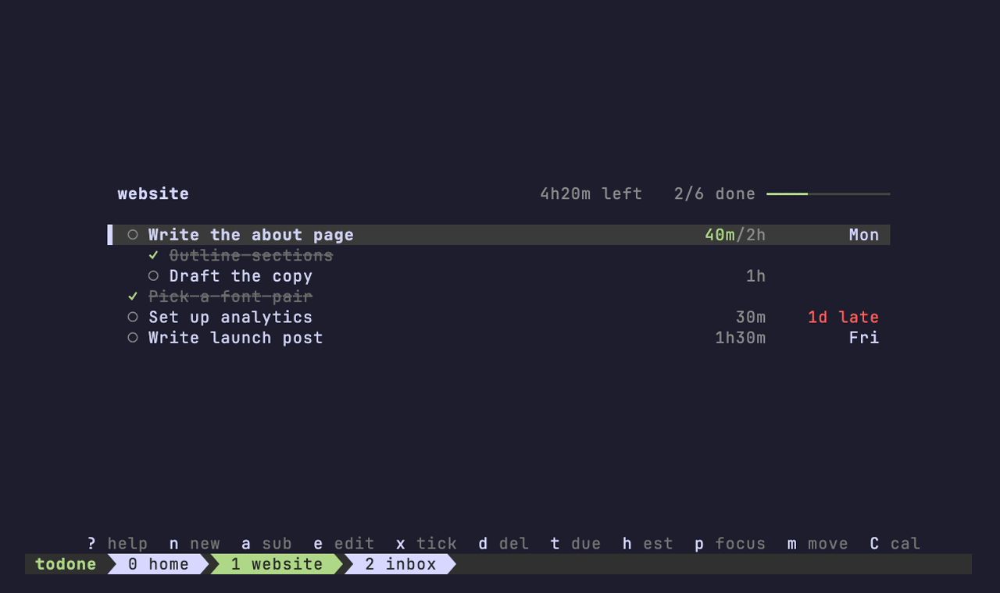
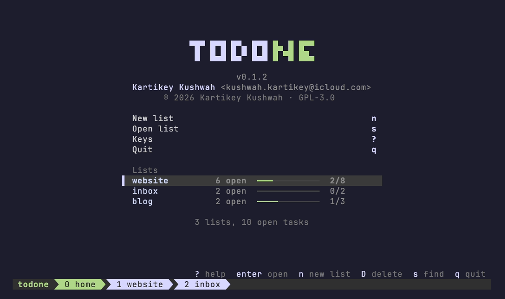
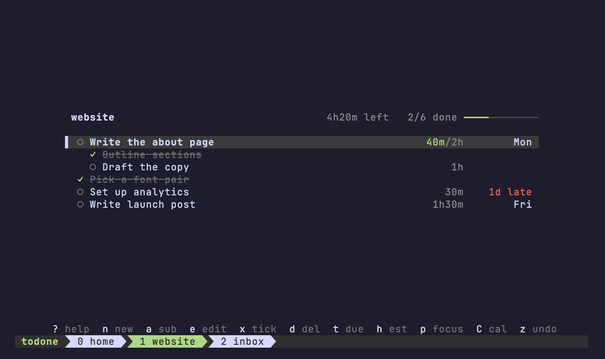
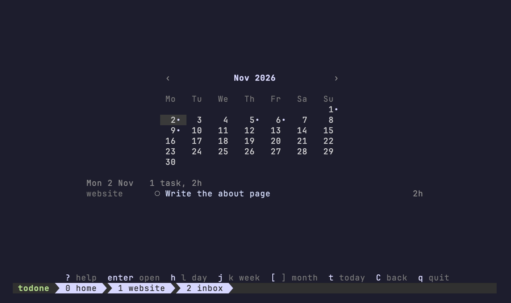
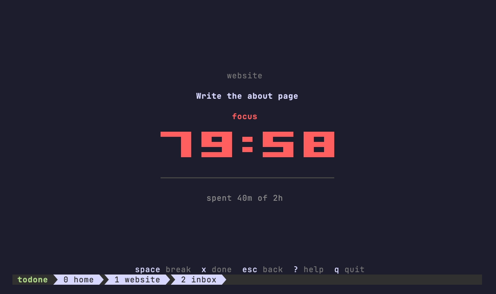

# todone

A tiny todo list for the macOS terminal. One POSIX `sh` file, no dependencies.
Tasks are plain Markdown checkboxes (`- [ ] task`), so you can read and edit them anywhere.



[Watch as MP4](demo/demo.mp4). Re-record with `vhs demo/demo.tape` ([vhs](https://github.com/charmbracelet/vhs)).

- Lists per folder, a home inbox, or a `TODO.md` in the repo
- A full-screen TUI with tabs, fuzzy pickers, undo and mouse support
- Subtasks, due dates, time estimates and a month calendar of what is due
- A focus timer per task that records the time you spend on it
- A start screen with every list and its progress
- One-shot commands for scripts and quick capture

## Install

```sh
brew install 1stdevfriend/tap/todone
echo "alias t=todone" >> ~/.zshrc
```

Or without Homebrew:

```sh
mkdir -p ~/.local/bin
curl -fsSL https://raw.githubusercontent.com/1stdevfriend/todone/main/todone -o ~/.local/bin/todone
chmod +x ~/.local/bin/todone
echo "alias t=todone" >> ~/.zshrc
```

Make sure `~/.local/bin` is on your `PATH`. macOS only for now.

The tab bar uses a powerline arrow, which needs a Nerd Font or Powerline font. Without one, set `TODONE_SEP=''` (or any character, e.g. `TODONE_SEP='>'`).

## Where tasks live

- **Per directory, automatically:** in `~/repos/blog`, tasks go to the list `blog`, kept in `~/.todone/blog.md`. In `$HOME` it is `inbox`.
- **In the repo:** `t init` creates `./TODO.md` (moving in that directory's existing list, if any); from then on that directory and its subdirectories use it, the way git finds `.git`. Commit it if you want.
- **Any list from anywhere:** `t -w inbox n "call mum"`.

Set `TODONE_HOME` to move `~/.todone`.

A list is plain Markdown, with fields in the [Obsidian Tasks](https://publish.obsidian.md/tasks/) emoji style:

```markdown
- [ ] Write launch post ⏱ 2h 📅 2026-11-02
  - [x] Outline ⏳ 50m
  - [ ] Pick a title ⏱ 30m
```

An indented task is a subtask of the one above it (one level). `📅` is the due date, `⏱` the estimate, `⏳` the time spent on it in focus mode.

## TUI

Run `t` with no arguments. Every list you open becomes a tab in the bottom bar.

### Home



The start screen shows every list with its open tasks and progress. `t` opens here when the current folder has no list yet, and deleting a list brings you back here. Reach it any time with `0` or the first tab.

| key | action |
|-----|--------|
| `j` `k` / arrows, `Enter` | pick a list, open it |
| `n` | new list (named after the current folder by default), then its first task |
| `D` | delete the selected list (moved to the Trash; `z` brings it back) |
| `s`, `?`, `q` | open a list, help, quit |

The menu items and lists are clickable too.

### Lists



| key | action |
|-----|--------|
| `j` `k` / arrows, `g` `G` | move, top, bottom |
| `n` | new task |
| `N` | add many: one task per line, empty line or Esc ends (pasting works) |
| `a` | add a subtask under the selected task |
| `>` `<` | make it a subtask of the task above / a task again |
| `e` | edit, prefilled with the current text |
| `x` / space | tick / untick |
| `d` | delete, with its subtasks (no prompt; `z` brings it back) |
| `t` | due date: `today`, `tom`, `fri`, `+3`, `2w`, `11-02`, `2026-11-02`; empty clears |
| `h` | estimate: `2h`, `1.5`, `30m`, `1h30m`; empty clears |
| `p` | focus on the task (see below) |
| `m` | move to another list (with its subtasks); pick it or type a new name. One `z` undoes it |
| `C` | calendar |
| `z` | undo, as many steps as you like (per session; refuses if the file was changed outside todone) |
| `/` | fuzzy-find a task |
| `s` | fuzzy-open a list with live preview; type a new name to create one |
| `0`, `1`–`9`, `Tab` / `Shift-Tab` | home, jump to a tab, cycle tabs |
| `c` | close tab |
| `D` | delete the list (moved to the Trash; `z` brings it back) and go home |
| `E` | open the list in `$EDITOR` |
| `?` | help |
| `q` | quit |

Due dates show as `today`, `tomorrow`, a weekday, `Nov 2`, or `3d late` in red. Time shows as spent/estimate, e.g. `40m/2h` (red once over the estimate); the header sums the estimated time still left.

### Calendar



`C` opens a month grid of every list's due tasks: a dot marks a day with open tasks (red once it is past), and the selected day's tasks are listed under the grid, with anything overdue when the day is today. `h` `l` move a day, `j` `k` a week, `[` `]` a month, `t` jumps to today, Enter picks one of the day's tasks and opens it, and `C` or Esc goes back. Click a day to select it, click it again to open its tasks.

### Focus



`p` opens the selected task on its own screen with a big timer. Focus runs for what is left of the task's estimate, or 25 minutes when it has none (or it is used up). `Space` switches between focus and a 5 minute break whenever you want; nothing switches by itself. When a timer runs out the bell rings once and it keeps counting as overtime, since an estimate is a guess and the work may not be done. `x` ticks the task off, Esc goes back to the list.

Every stretch of focus is added to the task as `⏳` time spent (whole minutes), so it stays with the task for as long as it is in the list; `z` undoes the last one. Set other default lengths in minutes with `TODONE_POMO='50 10'`.

In text boxes: Enter saves, Esc cancels, Backspace, Ctrl-U clears, Ctrl-W deletes a word.

**Mouse:** click a tab to switch, a task to select it, its ○/✓ to tick it, and a selected task again to edit it. The key hints above the tab bar are buttons. In pickers, click a result to open it or click outside to close. The wheel scrolls. While the TUI is open, select text with Shift-drag (Option-drag in iTerm2 / Terminal.app).

## Commands

The same actions as one-shot commands, for scripts and quick capture:

```sh
t n "write the report"   # new
t a 1 "find sources"     # subtask under task 1
t due 1 fri              # due date (t due 1 '' clears)
t est 1 2h               # estimate
t m 1 inbox              # move to another list
t l                      # list (plain `t` lists too when piped)
t x 1                    # tick / untick
t e 1 "write the draft"  # edit (t e alone opens $EDITOR)
t d 1                    # delete
t s                      # show all lists
t D                      # delete this list (moved to the Trash)
t init                   # keep this folder's list in ./TODO.md
t --version              # or t v
```

## Test

```sh
sh test.sh
```

## Author

Kartikey Kushwah <kushwah.kartikey@icloud.com>

## License

Copyright © 2026 Kartikey Kushwah. GPL-3.0. You can use, change and share todone; if you distribute a modified version, you must release its source under the GPL too. See [LICENSE](LICENSE).
